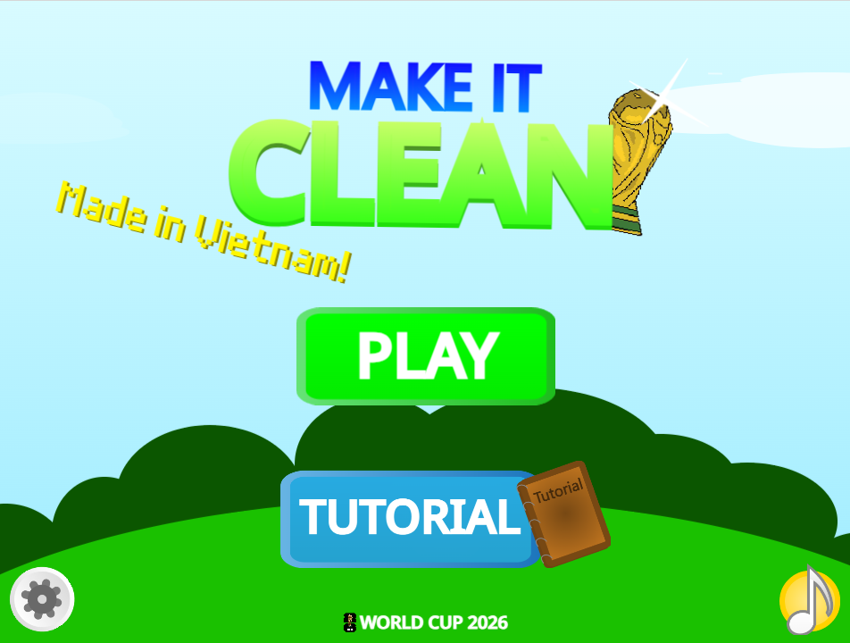

# Make-It-Clean
HGGMco15 and  MingTheCreaterVN present:
MAKE IT CLEAN
___________________________________________
In this game, your objectives is to collect as most trash as possible,
you can also convert these trash to coin and exchange them for goods 
in the shop

___________________________________________
*How to use save codes:
- Go to Settings -> choose Save Code
- Copy the code from the list and paste it in a document
- Restart the game, go to setting and choose Load Save Game
- Paste the code
And done! (Note: the saving system is still have not done yet, i just leave this information here)

*Attention: I used some famous footballer's statements about envriomental problems in the game, and they ACTUALLY said those (Ronaldo tweet about Amazon in August 2019, and Messi made his statement during the COP28 climate summit)

UPDATE LOG
1.0.0: First release
1.1.0: Added Shop and Coins
1.2.0 (Current version): Added more item to Shop. World Cup 2026 Event
*Upcoming updates: World Cup 2.0: Build your ultimate team (guys i know ts is cringe and pretty much not related to the game but it's just an event and i just want to make this interesting ;-;)
